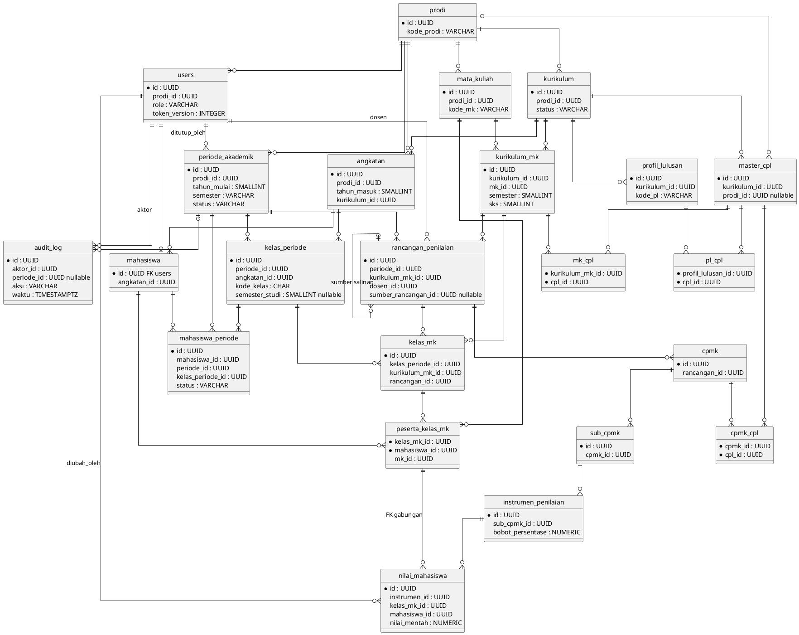
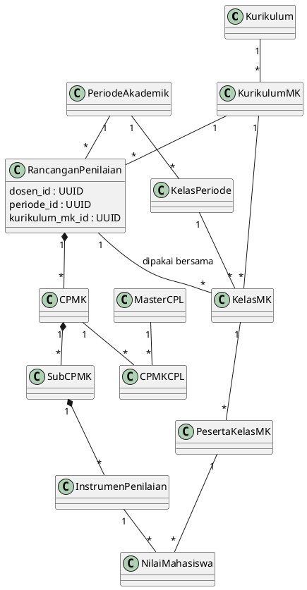
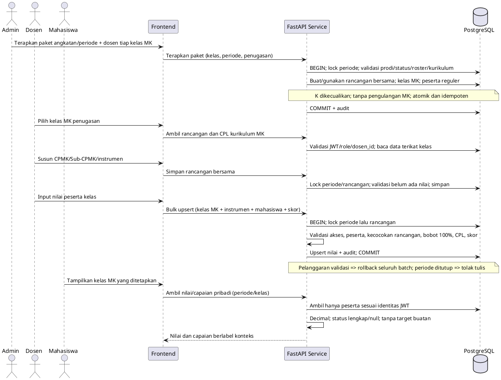
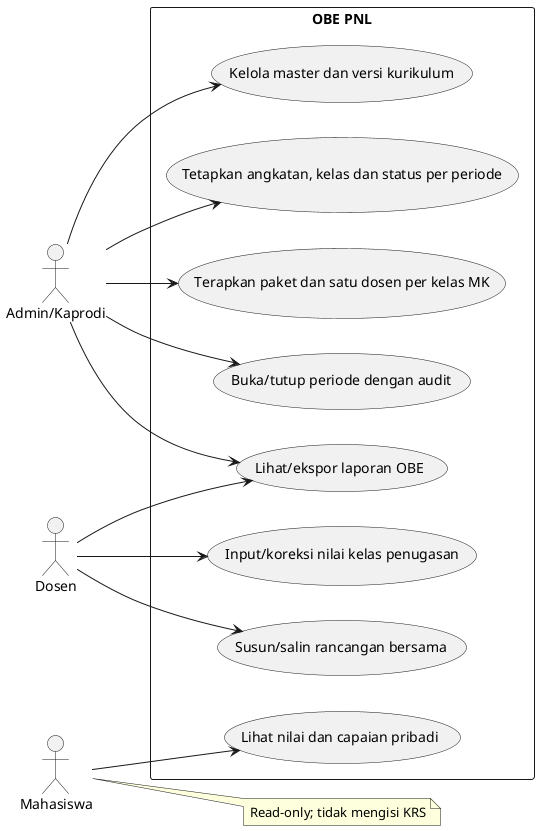
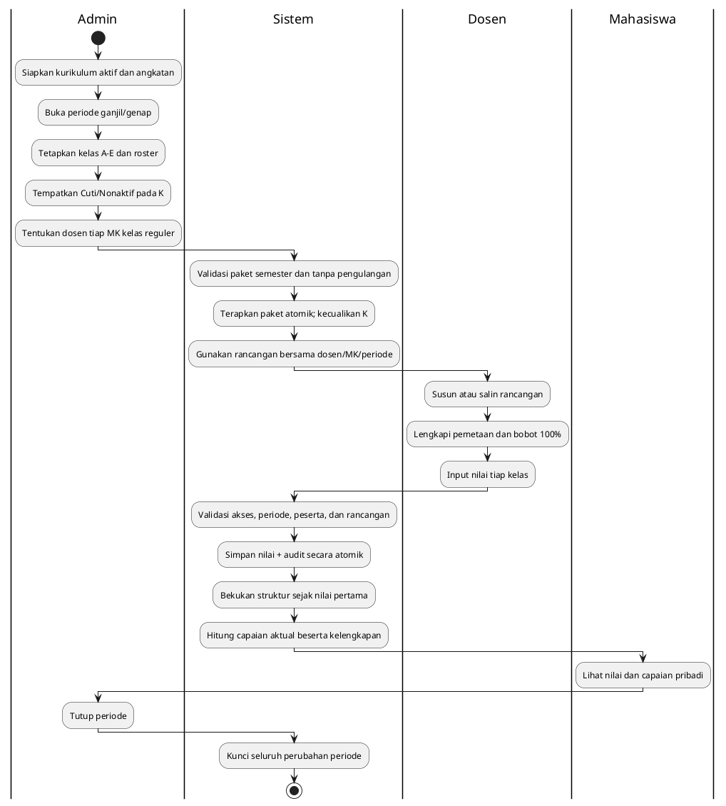

# SCHEMA.md - Skema Akademik dan Kalkulasi OBE PNL

Sumber teknis skema PostgreSQL dan agregasi OBE. Revisi pra-migrasi berdasarkan keputusan pengguna 17 November 2026 (menggantikan skema awal 11 tabel), ditambah modul Profil Lulusan dan matriks PL–CPL pada migrasi `20261126_0002` (**23 tabel**). Model SQLAlchemy dan migrasi tersedia di `backend/`. Aturan aktor mengikuti `AGENTS.md` §2.

## 1. Skema Fisik PostgreSQL

Terdapat **23 tabel**. Semua entitas utama memakai `id UUID` sebagai PK; junction `mk_cpl`, `pl_cpl`, `cpmk_cpl`, dan `peserta_kelas_mk` memakai PK gabungan. Kolom wajib `NOT NULL` kecuali dinyatakan nullable. FK default `ON DELETE RESTRICT`; pengecualian CASCADE dinyatakan eksplisit. Waktu memakai `TIMESTAMPTZ`, disimpan UTC dan ditampilkan WIB.

### 1.1. Identitas, Prodi, dan Angkatan

| Tabel | Kolom dan constraint |
| --- | --- |
| `prodi` | `id`, `kode_prodi VARCHAR(20) UNIQUE` (contoh `TI`), `nama_prodi VARCHAR(100)`, `jenjang VARCHAR(10)`, `aktif BOOLEAN DEFAULT true`. Peluncuran awal hanya Teknik Informatika. |
| `users` | `id`, `prodi_id UUID FK prodi`, `nim_nidn VARCHAR(20) UNIQUE`, `nama VARCHAR(100)`, `email VARCHAR(100) UNIQUE`, `role VARCHAR(20) CHECK IN ('Admin','Dosen','Mahasiswa')`, `password_hash TEXT`, `aktif BOOLEAN DEFAULT true`, `token_version INTEGER DEFAULT 0 CHECK >= 0` (pencabutan seluruh JWT pengguna saat logout). Prodi asal disimpan untuk semua pengguna; dosen hanya mengakses penugasan eksplisit. |
| `angkatan` | `id`, `prodi_id UUID FK prodi`, `tahun_masuk SMALLINT`, `kurikulum_id UUID FK kurikulum`; `UNIQUE(prodi_id, tahun_masuk)`. Satu angkatan menggunakan satu versi kurikulum. Penetapan kurikulum dibekukan setelah paket pertama diterapkan. |
| `mahasiswa` | `id UUID PK/FK users`, `angkatan_id UUID FK angkatan`. Hanya users berperan Mahasiswa; prodi pengguna harus sama dengan prodi angkatan. |

`users.aktif` mengatur akses akun, bukan status akademik cuti/nonaktif. Admin tidak otomatis memiliki hak menginput nilai sebagai Dosen. Perluasan lintas prodi tidak memerlukan penghapusan konteks prodi, tetapi manajemen akses lintas prodi tetap pekerjaan berikutnya.

### 1.2. Versi Kurikulum dan Paket MK

| Tabel | Kolom dan constraint |
| --- | --- |
| `kurikulum` | `id`, `prodi_id UUID FK prodi`, `kode_kurikulum VARCHAR(30)`, `nama VARCHAR(100)`, `status VARCHAR(10) CHECK IN ('Draft','Aktif','Arsip')`; `UNIQUE(prodi_id, kode_kurikulum)`. |
| `mata_kuliah` | `id`, `prodi_id UUID FK prodi`, `kode_mk VARCHAR(20)`, `nama_mk VARCHAR(100)`, `deskripsi TEXT nullable`, `aktif BOOLEAN DEFAULT true`; `UNIQUE(prodi_id, kode_mk)`. Identitas MK lintas versi; kode tidak didaur ulang untuk MK lain. |
| `kurikulum_mk` | `id`, `kurikulum_id UUID FK kurikulum`, `mk_id UUID FK mata_kuliah`, `nama_mk VARCHAR(100)`, `sks SMALLINT CHECK > 0`, `semester SMALLINT CHECK BETWEEN 1 AND 8`, `deskripsi TEXT nullable`; `UNIQUE(kurikulum_id, mk_id)`. Nama/deskripsi merupakan salinan per versi, tidak membaca ulang nama master untuk laporan lama. |
| `master_cpl` | `id`, `kurikulum_id UUID FK kurikulum`, `prodi_id UUID FK prodi nullable`, `kode_cpl VARCHAR(10)`, `kategori VARCHAR(5) CHECK IN ('S','KU','P','KK')`, `deskripsi TEXT`; `UNIQUE(kurikulum_id, kode_cpl)`. Prodi null hanya untuk CPL nasional S/KU, namun rumusannya tetap disimpan per versi kurikulum. |
| `mk_cpl` | `kurikulum_mk_id UUID PK/FK kurikulum_mk ON DELETE CASCADE`, `cpl_id UUID PK/FK master_cpl RESTRICT`, `urutan_rps INTEGER nullable CHECK > 0`. CPL harus berasal dari kurikulum yang sama. Nama kolom urutan lama dipertahankan; tidak menambah modul RPS. |
| `profil_lulusan` | `id`, `kurikulum_id UUID FK kurikulum`, `kode_pl VARCHAR(10)`, `nama_pl VARCHAR(150)`, `bidang_kerja TEXT nullable`, `deskripsi TEXT`; `UNIQUE(kurikulum_id, kode_pl)`. Disimpan per versi kurikulum; versi `Aktif`/`Arsip` bersifat read-only dan disalin saat `salin`. |
| `pl_cpl` | `profil_lulusan_id UUID PK/FK profil_lulusan ON DELETE CASCADE`, `cpl_id UUID PK/FK master_cpl RESTRICT`. CPL harus berasal dari kurikulum dan prodi yang sama. |

Paket = seluruh `kurikulum_mk` dengan kurikulum dan semester yang sama. Satu angkatan menerima paket yang sama untuk semester studi yang sama, walaupun dosen antarkelas berbeda. Tidak perlu tabel paket duplikat. MK harus berasal dari prodi kurikulum; CPL lokal juga harus sesuai prodi tersebut.

Kurikulum Draft boleh disusun bertahap. Aktivasi memerlukan setiap MK paket memiliki pembebanan CPL, kode unik, serta semester/SKS valid. Setelah Aktif, isi kurikulum, snapshot MK, CPL, dan pemetaan tidak dapat diubah/dihapus; revisi dengan salin ke versi Draft baru. Arsip menghentikan pemakaian untuk angkatan baru, tetapi angkatan lama tetap dapat menggunakannya. Perubahan master MK tidak menimpa snapshot kurikulum lama. Kesamaan kode CPL antarversi tidak otomatis berarti boleh digabung saat agregasi.

### 1.3. Periode, Kelas, dan Status Mahasiswa

| Tabel | Kolom dan constraint |
| --- | --- |
| `periode_akademik` | `id`, `prodi_id UUID FK prodi`, `tahun_mulai SMALLINT`, `semester VARCHAR(6) CHECK IN ('Ganjil','Genap')`, `status VARCHAR(7) CHECK IN ('Dibuka','Ditutup') DEFAULT 'Dibuka'`, `ditutup_pada TIMESTAMPTZ nullable`, `ditutup_oleh UUID FK users nullable`; `UNIQUE(prodi_id, tahun_mulai, semester)`. Label tahun diturunkan: tahun_mulai 2026 → 2026/2027. Tidak ada semester pendek. |
| `kelas_periode` | `id`, `periode_id UUID FK periode_akademik`, `angkatan_id UUID FK angkatan`, `kode_kelas CHAR(1) CHECK IN ('A','B','C','D','E','K')`, `semester_studi SMALLINT nullable`; `UNIQUE(periode_id, angkatan_id, kode_kelas)`. CHECK: A–E membutuhkan semester_studi 1–8; K membutuhkan null. |
| `mahasiswa_periode` | `id`, `mahasiswa_id UUID FK mahasiswa`, `periode_id UUID FK periode_akademik`, `kelas_periode_id UUID FK kelas_periode`, `status VARCHAR(8) CHECK IN ('Aktif','Cuti','Nonaktif')`; `UNIQUE(mahasiswa_id, periode_id)`. |

Prodi periode, angkatan, dan mahasiswa harus cocok. `mahasiswa_periode.periode_id` harus sama dengan periode kelas; angkatan mahasiswa harus sama dengan angkatan kelas. Status Aktif hanya kelas A–E; Cuti/Nonaktif hanya K. K menyimpan status individual, bukan menebaknya dari nama kelas.

Tingkat tahun = `(semester_studi + 1) // 2`, maksimum 4. Label tampilan = kode prodi + tingkat + huruf, misalnya TI-3C untuk semester 5/6. K ditampilkan `TI-K` beserta angkatan dan periode untuk membedakan kelompok. Label bukan identitas unik global. Ganjil hanya semester studi 1/3/5/7; Genap hanya 2/4/6/8. Seluruh kelas reguler satu angkatan dalam satu periode harus memakai semester studi yang sama.

Admin membuat daftar kelas dan penempatan mahasiswa untuk setiap periode. Boleh menyalin roster periode sebelumnya sebagai draft input, tetapi penempatan harus diperiksa sebelum menerapkan paket; jangan memindahkan/menaikkan kelas dengan mengedit baris periode lama. Huruf biasanya tetap, namun perubahan hanya dicatat di periode baru. Usia angkatan tidak otomatis menentukan semester mahasiswa, terutama untuk K. Pengaktifan kembali dari K dilakukan Admin pada periode baru dengan kelas reguler dan semester studi yang sesuai; jangan membuat kelas K menjadi kelas perkuliahan atau otomatis menetapkan paket ke K.

### 1.4. Pelaksanaan MK dan Rancangan Bersama

| Tabel | Kolom dan constraint |
| --- | --- |
| `rancangan_penilaian` | `id`, `periode_id UUID FK periode_akademik`, `kurikulum_mk_id UUID FK kurikulum_mk`, `dosen_id UUID FK users`, `sumber_rancangan_id UUID FK rancangan_penilaian nullable`; `UNIQUE(periode_id, kurikulum_mk_id, dosen_id)`. Dosen wajib role Dosen. |
| `kelas_mk` | `id`, `kelas_periode_id UUID FK kelas_periode`, `kurikulum_mk_id UUID FK kurikulum_mk`, `rancangan_id UUID FK rancangan_penilaian`; `UNIQUE(kelas_periode_id, kurikulum_mk_id)`. Hanya kelas reguler. |
| `peserta_kelas_mk` | `kelas_mk_id UUID PK/FK kelas_mk`, `mahasiswa_id UUID PK/FK mahasiswa`, `mk_id UUID FK mata_kuliah`; `UNIQUE(mahasiswa_id, mk_id)` untuk melarang pengulangan MK lintas kelas/periode. `mk_id` merupakan kolom integritas, harus sama dengan master MK melalui kelas_mk → kurikulum_mk; bukan input bebas klien. |

Satu kelas MK memiliki tepat satu dosen melalui `rancangan_id`; tidak menyimpan dosen kedua pada kelas untuk menghindari ketidaksesuaian. Satu rancangan dapat dipakai banyak kelas pada periode yang sama. Rancangan hanya boleh dipakai kelas dengan periode dan `kurikulum_mk` yang sama. Dosen sama/MK sama/periode sama pada versi kurikulum sama wajib berbagi rancangan, ditegakkan oleh constraint unik; tidak membuat salinan independen per kelas. Tidak ada tim dosen.

Penerapan paket oleh Admin adalah transaksi massal: pilih angkatan/periode → validasi roster Aktif dan kurikulum angkatan → ambil MK semester → tentukan dosen per MK per kelas → buat/gunakan ulang rancangan → buat kelas MK → tambahkan peserta dari roster kelas. K dikecualikan. Jika satu penugasan belum ada atau validasi gagal, seluruh penerapan batch ditolak; tidak membuat kelas MK tanpa dosen. Menjalankan ulang paket yang sama tidak menggandakan data dan tidak mereset nilai. Paket/kelas baru untuk MK yang sudah pernah diambil mahasiswa ditolak, bukan membuat percobaan ulang.

Sebelum ada nilai, Admin boleh memperbaiki penempatan/penugasan dalam transaksi yang menjaga konsistensi roster dan peserta paket. Jika mahasiswa atau kelas yang terdampak sudah memiliki nilai, perpindahan/penghapusan kepesertaan atau penggantian dosen ditolak; jangan menghapus atau memindahkan nilai otomatis. Perubahan kelas/status dicatat untuk periode berikutnya. Kebijakan koreksi struktural di tengah periode setelah ada nilai berada di luar lingkup awal.

### 1.5. CPMK, Instrumen, dan Nilai

| Tabel | Kolom dan constraint |
| --- | --- |
| `cpmk` | `id`, `rancangan_id UUID FK rancangan_penilaian ON DELETE CASCADE`, `kode_cpmk VARCHAR(20)`, `deskripsi TEXT`; `UNIQUE(rancangan_id, kode_cpmk)`. Menggantikan kepemilikan langsung oleh master MK. |
| `cpmk_cpl` | `cpmk_id UUID PK/FK cpmk ON DELETE CASCADE`, `cpl_id UUID PK/FK master_cpl RESTRICT`. CPL harus ada di mk_cpl untuk kurikulum_mk rancangan. |
| `sub_cpmk` | `id`, `cpmk_id UUID FK cpmk ON DELETE CASCADE`, `kode_sub VARCHAR(20)`, `deskripsi TEXT`; `UNIQUE(cpmk_id, kode_sub)`. |
| `instrumen_penilaian` | `id`, `sub_cpmk_id UUID FK sub_cpmk ON DELETE CASCADE`, `nama_instrumen VARCHAR(100)`, `jenis_instrumen VARCHAR(20) CHECK IN ('Tugas','Kuis','Praktikum','UTS','UAS')`, `bobot_persentase NUMERIC(5,2) CHECK > 0 AND <= 100`. Nama membedakan misalnya Tugas 1/Tugas 2. |
| `nilai_mahasiswa` | `id`, `instrumen_id UUID FK instrumen_penilaian RESTRICT`, `kelas_mk_id UUID`, `mahasiswa_id UUID`, `nilai_mentah NUMERIC(5,2) CHECK BETWEEN 0 AND 100`, `waktu_input TIMESTAMPTZ DEFAULT now()`, `diubah_oleh UUID FK users`; FK gabungan `(kelas_mk_id, mahasiswa_id)` → peserta_kelas_mk RESTRICT; `UNIQUE(instrumen_id, kelas_mk_id, mahasiswa_id)`. |

Nilai hanya boleh ditulis jika instrumen dan kelas MK menunjuk rancangan yang sama serta mahasiswa adalah peserta kelas tersebut. Periksa status Aktif pada roster periode dan akun dosen penulis. Keterkaitan ke kelas wajib karena instrumen dipakai bersama beberapa kelas. Tidak ada nilai global mahasiswa–master MK.

### 1.6. Audit dan Penguncian

| Tabel | Kolom dan constraint |
| --- | --- |
| `audit_log` | `id`, `aktor_id UUID FK users`, `periode_id UUID FK periode_akademik nullable`, `aksi VARCHAR(50)`, `entitas VARCHAR(50)`, `entitas_id UUID`, `alasan TEXT nullable`, `sebelum JSONB nullable`, `sesudah JSONB nullable`, `waktu TIMESTAMPTZ DEFAULT now()`. Untuk junction ber-PK gabungan, entitas_id menunjuk induk (kelas MK atau CPMK) dan JSON menyertakan kedua kunci junction. Append-only melalui layanan; jangan menyimpan password_hash, token, atau secret pada JSON audit. |

* Admin menutup/membuka kembali periode; alasan nonkosong wajib saat membuka kembali. Audit status dan waktu pelaku disimpan atomik. Riwayat penutupan sebelumnya tetap ada dalam audit walaupun kolom status terkini berubah.
* Ditutup = read-only atas kelas, roster, peserta paket, penugasan, rancangan, dan nilai pada periode tersebut; laporan/ekspor historis tetap dapat dibaca sesuai hak akses. Periode boleh ditutup dengan nilai belum lengkap, dan status belum lengkap tetap dipertahankan.
* Seluruh endpoint tulis terkait mengunci baris periode dalam transaksi (`SELECT ... FOR UPDATE`) lalu memeriksa status, sehingga penutupan tidak berlomba dengan bulk nilai atau penerapan paket. Jangan hanya mengandalkan flag frontend.
* Begitu ada satu nilai pada salah satu kelas pengguna rancangan, **seluruh struktur rancangan bersama** dibekukan: CPMK, pemetaan CPL, Sub-CPMK, instrumen, dan bobot. Mengunci baris rancangan pada perubahan struktur maupun input nilai pertama mencegah race. Kelas terkait tidak boleh dialihkan ke dosen/rancangan lain setelah mempunyai nilai.
* Periode terbuka membolehkan dosen melengkapi/mengoreksi nilai mentah dengan audit nilai sebelum/sesudah; pembukaan kembali oleh Admin mengembalikan hak tersebut, tanpa hak Admin menginput nilai dan tanpa melepas pembekuan struktur.
* Salin rancangan: dosen dapat memilih sumber rancangan miliknya dari periode lain pada kurikulum_mk yang sama; buat UUID baru untuk seluruh anak dan pemetaan, simpan sumber_rancangan_id, jangan salin peserta/nilai. Tujuan adalah rancangan kosong yang telah dibuat Admin melalui penugasan kelas pada periode terbuka: tanpa CPMK, instrumen, atau nilai. Isi salinan dimasukkan atomik ke tujuan tersebut; rancangan yang sudah berisi tidak boleh ditimpa. Salinan mulai sebagai draft dan dapat diedit sampai input nilai pertama. Lintas versi kurikulum dirancang ulang, tidak disalin otomatis.
* Gunakan penonaktifan/arsip untuk master yang dipakai. RESTRICT melindungi penghapusan mahasiswa, dosen, peserta, kelas, periode, kurikulum, dan instrumen yang memiliki riwayat. Cascade anak rancangan hanya aman untuk draft tanpa nilai; nilai tetap melindungi induknya melalui RESTRICT.

### 1.7. Integritas Layanan dan Indeks

* FK/UNIQUE/CHECK pada tabel adalah minimum constraint database. Kesamaan prodi, angkatan, semester, kurikulum, role, roster, dan rancangan lintas relasi divalidasi layanan dalam transaksi. Jangan mengandalkan filter dropdown atau membolehkan penulisan SQL di luar service.
* Gunakan FK gabungan untuk peserta pada nilai. Validasi lintas relasi yang belum memiliki FK gabungan harus diperiksa lagi saat parent diubah; setelah digunakan, parent yang memengaruhi konteks historis tidak boleh dialihkan.
* Draft rancangan boleh belum memiliki semua pemetaan/instrumen. Istilah draft/kesiapan rancangan diturunkan dari isi dan keberadaan nilai, bukan status kurikulum atau kolom status rancangan terpisah. Setiap CPMK wajib terpetakan dan total bobot **seluruh instrumen per rancangan** harus 100.00 sebelum input nilai atau laporan capaian; penambahan bertahap tidak boleh melebihi 100.00. Rancangan kosong/tanpa instrumen belum siap dinilai.
* Seluruh bulk input nilai memakai Decimal, skor 0–100, duplikat pasangan pada satu payload ditolak, dan transaksi atomik. Upsert hanya berdasarkan `(instrumen_id, kelas_mk_id, mahasiswa_id)`; rollback seluruh payload bila ada peserta, instrumen, akses, lock, atau skor tidak valid. Audit ditulis dalam transaksi yang sama.
* Akses Dosen ditelusuri nilai/instrumen → rancangan → dosen_id serta kelas MK terkait. Rekap kelas memfilter kelas_mk_id, bukan semua kelas yang memakai instrumen tersebut. Mahasiswa selalu difilter dari identitas JWT; jangan percaya mahasiswa_id dari klien untuk membatasi akses.
* Admin dibatasi prodi miliknya; menautkan pengguna/kurikulum/kelas dari prodi lain ditolak. Multi-prodi bukan fitur peluncuran awal, tetapi konteks tidak boleh hilang pada query.
* Tambahkan indeks semua FK yang belum menjadi awalan PK/UNIQUE, khususnya mahasiswa_id pada peserta, rancangan_id pada kelas_mk, periode_id/dosen_id pada rancangan, kelas_mk_id/mahasiswa_id pada nilai, dan periode_id/waktu pada audit. Query laporan harus membawa periode + kelas/kurikulum yang eksplisit.

### 1.8. Penggantian Skema Awal

| Rancangan awal | Rancangan pra-migrasi |
| --- | --- |
| pengampu_krs(user_id, mk_id, status) | Penugasan satu dosen melalui rancangan_penilaian pada kelas_mk, dan junction peserta_kelas_mk khusus mahasiswa. Tabel lama tidak dibuat. |
| mata_kuliah.sks/semester | kurikulum_mk.sks/semester, bersama snapshot nama/deskripsi. |
| CPL tanpa versi | master_cpl.kurikulum_id; rumusan nasional S/KU tetap boleh prodi_id null, tetapi dipisahkan per versi. |
| mk_cpl.mk_id | mk_cpl.kurikulum_mk_id. |
| cpmk.mk_id | cpmk.rancangan_id. |
| Nilai hanya instrumen + mahasiswa | Nilai instrumen + kelas MK + mahasiswa peserta. |
| CASCADE pengguna/instrumen hingga nilai | RESTRICT untuk seluruh riwayat nilai. |

Skema dasar 21 tabel diterapkan sebagai **migrasi awal** `20261117_0001`, dan penambahan `profil_lulusan` serta `pl_cpl` (total **23 tabel**) diterapkan pada **migrasi** `20261126_0002`, bukan instruksi DROP atau migrasi data produksi. Jangan membuat model berdasarkan skema lama. Upgrade/downgrade hanya diuji pada database disposable; inventarisasi data dan backup wajib sebelum perubahan database produksi.

## 2. Kalkulasi OBE

Seluruh perhitungan di service FastAPI menggunakan Decimal, pembulatan dua desimal hanya pada hasil akhir. Nilai belum diinput **bukan nol**. Tanpa perubahan rumus dasar, konteks pengambilan instrumen kini selalu dari peserta kelas MK pada periode/kurikulum yang diminta.

1. Skor terbobot instrumen: `S_i = nilai_mentah_i × bobot_persentase_i / 100`.
2. Sub-CPMK: `sum(nilai_mentah_i × bobot_i) / sum(bobot_i)` untuk instrumen Sub-CPMK tersebut pada satu peserta kelas MK.
3. CPMK: rumus yang sama untuk seluruh instrumen unik di bawah CPMK; bukan rata-rata sederhana Sub-CPMK.
4. CPL: ambil instrumen unik dari CPMK yang dipetakan melalui cpmk_cpl. Gabungkan pembilang dan penyebut dari MK yang diikuti mahasiswa, pada **versi kurikulum yang sama** dan filter periode yang diminta. Tanpa bobot SKS tambahan. Satu instrumen dihitung sekali per CPL, tetapi boleh berkontribusi penuh pada beberapa CPL.

Contoh: nilai 80 berbobot 20 dan nilai 60 berbobot 30 menghasilkan 68.00. Penyebut nol atau satu nilai yang dibutuhkan belum diinput menghasilkan `null` dan status `Belum lengkap`. CPMK/CPL tanpa instrumen evaluasi juga tidak menghasilkan nol.

* Jika rancangan belum memenuhi pemetaan/bobot, capaian tidak dihitung: angka null, status `Belum siap dinilai`. Nilai mentah yang sah tetap dapat dilihat; status kesiapan tidak disamarkan menjadi nilai nol.
* Laporan satu kelas MK menggunakan peserta kelas itu saja, walaupun rancangan dipakai kelas lain. Rekap = rata-rata capaian mahasiswa lengkap, disertai jumlah lengkap/total peserta. Tanpa mahasiswa lengkap → null. Rancangan bersama bukan alasan menggabungkan nilai kelas A dan B.
* Agregat CPL lintas MK dalam satu periode mengacu paket yang ditetapkan ke mahasiswa pada periode itu. Agregat kumulatif memakai paket yang sudah ditetapkan hingga periode pilihan, tidak memasukkan semester masa depan atau periode berstatus Cuti/Nonaktif tanpa peserta. Kelengkapan dinilai atas seluruh instrumen relevan yang diwajibkan, bukan hanya yang sudah bernilai.
* Laporan lintas kelas boleh diminta Dosen hanya atas kelas penugasannya; daftar kelas dan periode harus eksplisit. Hitung rata-rata mahasiswa lengkap dan jumlah lengkap/total, jangan merata-ratakan rata-rata kelas tanpa bobot jumlah peserta.
* Jangan menyatukan CPL lintas versi hanya dari kode/nama. Target capaian belum dikonfigurasi; chart hanya membawa capaian aktual, kode/label CPL/CPMK, status kelengkapan, konteks periode/kelas, serta jumlah mahasiswa lengkap/total bila rekap.

## 3. Diagram Akademik dan Alur

Diagram berikut adalah rancangan untuk implementasi; bukan API yang sudah tersedia.

### 3.1. ERD

### 3.2. Class Diagram Inti Penilaian

### 3.3. Sequence Diagram Paket hingga Nilai

### 3.4. Use Case

### 3.5. Activity Flow

## 4. Skenario Penerimaan sebelum Implementasi

1. Angkatan 2024, periode 2026/2027 Ganjil, semester studi 5 kelas C → TI-3C; angkatan 2026 semester 1 A → TI-1A. Semester 7/8 → tingkat 4. Label yang sama pada periode lain mempunyai UUID berbeda.
2. Seluruh kelas A–E angkatan/semester sama mendapat MK paket yang sama. K tidak dibuatkan kelas MK/peserta; status Cuti dan Nonaktif tetap dibedakan.
3. Roster periode baru tidak menimpa kelas/nilai periode lama; Admin dapat mengaktifkan kembali mahasiswa K tanpa membuat mahasiswa baru. Paket yang memuat MK yang pernah diikuti tetap ditolak sesuai batas tanpa pengulangan.
4. Dosen X mengajar MK sama pada A/B → rancangan_id sama. Dosen Y di C → rancangan berbeda. Nilai peserta A tidak muncul pada rekap B; mengganti penilaian X tidak memengaruhi Y.
5. Satu kelas MK tidak dapat mempunyai dua dosen. Instrumen rancangan X tidak dapat dipakai menginput nilai peserta kelas rancangan Y, walaupun kode MK sama.
6. Kurikulum baru dengan MK/CPL berkode sama tidak mengubah SKS, deskripsi, pemetaan, rancangan, dan laporan kurikulum lama. CPL lintas versi ditolak dalam pemetaan dan tidak digabung otomatis pada laporan.
7. Mahasiswa hanya melihat nilai pribadi; Dosen ditolak saat mengakses kelas lain; Admin tidak mendapat endpoint tulis nilai. Prodi lain ditolak pada resource terikat prodi.
8. Total bobot 99/101 atau CPMK belum dipetakan menolak seluruh bulk nilai. Skor 0 sah, skor hilang bukan 0. Payload sebagian salah tidak menyimpan sebagian nilai.
9. Nilai pertama membekukan struktur bersama semua kelas terkait. Penutupan periode serentak dengan tulis nilai diproses serial; tidak ada write lolos setelah lock ditutup. Buka kembali memerlukan Admin + alasan + audit; koreksi nilai tidak mengubah struktur.
10. Paket diterapkan dua kali tidak menggandakan peserta/rancangan; kegagalan satu baris me-rollback batch. Pengulangan MK lintas periode/kelas ditolak oleh UNIQUE mahasiswa/master MK.
11. Salin rancangan periode lama menghasilkan UUID anak baru, tanpa nilai/peserta, tetap menjaga laporan sumber. Salin ke rancangan kosong hasil penugasan berhasil; salinan lintas versi atau yang menimpa tujuan berisi ditolak.
12. Capaian 80×20 dan 60×30 → 68.00; nilai belum lengkap → null, bukan nol. Rekap menyertakan lengkap/total; periode masa depan tanpa paket tidak dianggap nilai hilang.

Fondasi dan layanan backend tahap 1–5 tersedia: master/kurikulum, angkatan/kelas/roster, paket/penugasan, rancangan bersama, bulk nilai, penutupan/pembukaan kembali periode, serta capaian pribadi dan kelas. Pengujian memakai PostgreSQL asli dengan migrasi, validasi transaksi/audit, RBAC, concurrency, dan rumus Decimal di atas. Ekspor CSV/PDF dan rekap lintas beberapa kelas tetap pekerjaan berikutnya; endpoint yang tersedia dan batasannya didokumentasikan dalam backend/README.md.
