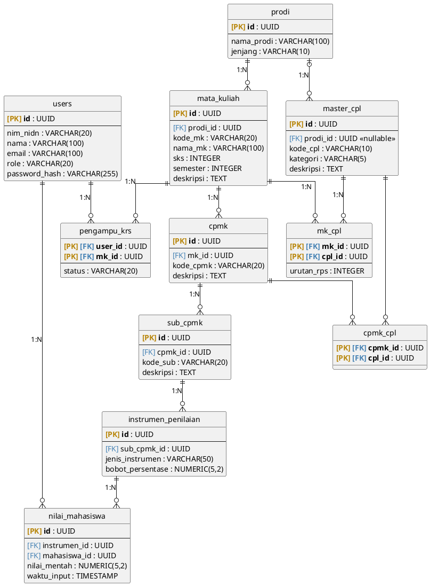
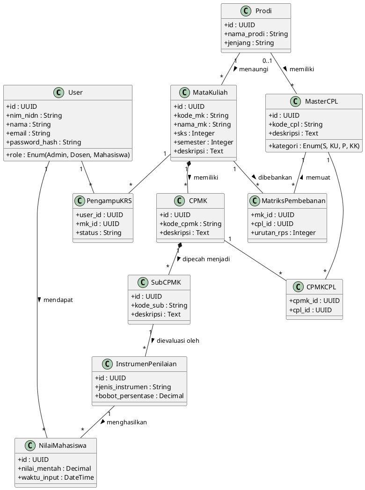
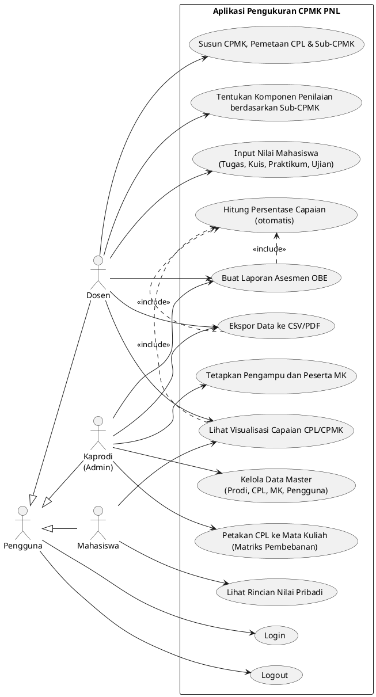
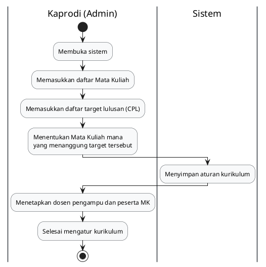

# SCHEMA.md - Arsitektur Data, Relasi Database, dan Logika Kalkulasi OBE

Dokumen ini berfungsi sebagai *single source of truth* teknis mengenai struktur basis data PostgreSQL, pemodelan sistem, dan rumus agregasi nilai *Outcome-Based Education* (OBE) pada proyek Politeknik Negeri Lhokseumawe (PNL).

---

## 1. Spesifikasi Tabel Database (PostgreSQL Physical Schema)

Entitas utama memakai `id UUID` sebagai PK. Tabel junction `mk_cpl`, `cpmk_cpl`, dan `pengampu_krs` memakai PK gabungan dari dua FK UUID.

### 1.1. Tabel Master & Autentikasi
* **`users`**
  * `id` (`UUID`, PK): Identitas unik pengguna.
  * `nim_nidn` (`VARCHAR(20)`, UNIQUE, NOT NULL): Nomor induk mahasiswa atau dosen.
  * `nama` (`VARCHAR(100)`, NOT NULL): Nama lengkap pengguna.
  * `email` (`VARCHAR(100)`, UNIQUE, NOT NULL): Email institusi untuk login.
  * `role` (`VARCHAR(20)`, NOT NULL): Hak akses (`Admin`, `Dosen`, `Mahasiswa`).
  * `password_hash` (`VARCHAR(255)`, NOT NULL): Kata sandi terenkripsi (*Bcrypt*).

* **`prodi`**
  * `id` (`UUID`, PK): Identitas unik program studi.
  * `nama_prodi` (`VARCHAR(100)`, NOT NULL): Nama program studi.
  * `jenjang` (`VARCHAR(10)`, NOT NULL): Jenjang pendidikan (misal: `D3`, `D4`).

* **`master_cpl`**
  * `id` (`UUID`, PK): Identitas unik Capaian Pembelajaran Lulusan.
  * `prodi_id` (`UUID`, FK $\rightarrow$ `prodi.id`, NULLABLE): Jika `NULL`, berarti merupakan CPL standar nasional (Sikap / Keterampilan Umum).
  * `kode_cpl` (`VARCHAR(10)`, NOT NULL): Kode unik CPL (misal: `CPL-01`).
  * `kategori` (`VARCHAR(5)`, NOT NULL): Kategori (`S`, `KU`, `P`, `KK`).
  * `deskripsi` (`TEXT`, NOT NULL): Rumusan deskripsi capaian lulusan.

* **`mata_kuliah`**
  * `id` (`UUID`, PK): Identitas unik mata kuliah.
  * `prodi_id` (`UUID`, FK $\rightarrow$ `prodi.id`, NOT NULL): Program studi pemilik mata kuliah.
  * `kode_mk` (`VARCHAR(20)`, NOT NULL): Kode mata kuliah (unik per prodi).
  * `nama_mk` (`VARCHAR(100)`, NOT NULL): Nama mata kuliah.
  * `sks` (`INTEGER`, NOT NULL): Bobot Satuan Kredit Semester.
  * `semester` (`INTEGER`, NOT NULL): Semester penempatan mata kuliah.
  * `deskripsi` (`TEXT`, NULLABLE): Deskripsi singkat mata kuliah.

### 1.2. Tabel Perantara (Junction Tables - Relasi Many-to-Many)
* **`mk_cpl`** *(Memecah relasi M:N antara `mata_kuliah` dan `master_cpl`)*
  * `mk_id` (`UUID`, PK, FK $\rightarrow$ `mata_kuliah.id`, `ON DELETE CASCADE`)
  * `cpl_id` (`UUID`, PK, FK $\rightarrow$ `master_cpl.id`, `ON DELETE RESTRICT`)
  * `urutan_rps` (`INTEGER`, NULLABLE): Urutan prioritas pemetaan di RPS.

* **`pengampu_krs`** *(Memecah relasi M:N antara `users` dan `mata_kuliah`)*
  * `user_id` (`UUID`, PK, FK $\rightarrow$ `users.id`, `ON DELETE CASCADE`)
  * `mk_id` (`UUID`, PK, FK $\rightarrow$ `mata_kuliah.id`, `ON DELETE CASCADE`)
  * `status` (`VARCHAR(20)`, NOT NULL): Peran dalam mata kuliah (`Dosen Pengampu` atau `Mahasiswa Mengambil`).

* **`cpmk_cpl`**: pemetaan M:N CPMK ke CPL.
  * `cpmk_id` (`UUID`, PK, FK → `cpmk.id`, `ON DELETE CASCADE`).
  * `cpl_id` (`UUID`, PK, FK → `master_cpl.id`, `ON DELETE RESTRICT`).
  * Service memvalidasi bahwa CPL ada pada `mk_cpl` untuk MK milik CPMK. Penghapusan pemetaan MK–CPL ditolak bila masih dipakai CPMK; perubahan diproses dalam transaksi.

### 1.3. Tabel Transaksi & Penilaian OBE
* **`cpmk`**
  * `id` (`UUID`, PK): Identitas unik Capaian Pembelajaran Mata Kuliah.
  * `mk_id` (`UUID`, FK $\rightarrow$ `mata_kuliah.id`, `ON DELETE CASCADE`, NOT NULL)
  * `kode_cpmk` (`VARCHAR(20)`, NOT NULL): Kode CPMK (misal: `CPMK-1`).
  * `deskripsi` (`TEXT`, NOT NULL): Rumusan kemampuan akhir yang direncanakan.

* **`sub_cpmk`**
  * `id` (`UUID`, PK): Identitas unik Sub-CPMK.
  * `cpmk_id` (`UUID`, FK $\rightarrow$ `cpmk.id`, `ON DELETE CASCADE`, NOT NULL)
  * `kode_sub` (`VARCHAR(20)`, NOT NULL): Kode Sub-CPMK (misal: `Sub-CPMK-1.1`).
  * `deskripsi` (`TEXT`, NOT NULL): Indikator pencapaian spesifik per tahapan belajar.

* **`instrumen_penilaian`**
  * `id` (`UUID`, PK): Identitas unik komponen evaluasi.
  * `sub_cpmk_id` (`UUID`, FK $\rightarrow$ `sub_cpmk.id`, `ON DELETE CASCADE`, NOT NULL)
  * `jenis_instrumen` (`VARCHAR(50)`, NOT NULL): Bentuk asesmen (Tugas, Kuis, Praktikum, UTS, UAS).
  * `bobot_persentase` (`NUMERIC(5,2)`, NOT NULL): Bobot kontribusi instrumen terhadap penilaian (total akumulasi per MK wajib $100.00$).

* **`nilai_mahasiswa`**
  * `id` (`UUID`, PK): Identitas unik entri nilai.
  * `instrumen_id` (`UUID`, FK $\rightarrow$ `instrumen_penilaian.id`, `ON DELETE CASCADE`, NOT NULL)
  * `mahasiswa_id` (`UUID`, FK $\rightarrow$ `users.id`, `ON DELETE CASCADE`, NOT NULL)
  * `nilai_mentah` (`NUMERIC(5,2)`, NOT NULL): Skor aktual mahasiswa ($0.00 \le \text{nilai} \le 100.00$).
  * `waktu_input` (`TIMESTAMP`, DEFAULT `NOW()`): Waktu pencatatan nilai.

### 1.4. Integritas dan validasi layanan
* `UNIQUE(instrumen_id, mahasiswa_id)` untuk nilai; bulk upsert harus atomik.
* `UNIQUE(prodi_id, kode_mk)`; nilai dan bobot memakai `Decimal`, CHECK nilai 0–100 dan bobot > 0 hingga 100.
* Status pengampu harus sesuai role pengguna. Nilai hanya untuk mahasiswa peserta MK; akses dosen ditelusuri dari instrumen/Sub-CPMK/CPMK hingga MK yang diampu.
* Draft boleh belum lengkap (termasuk pemetaan CPMK), tetapi input nilai dan laporan capaian mensyaratkan setiap CPMK terpetakan serta total bobot MK 100%. Penambahan instrumen bertahap tidak harus langsung 100%, tetapi tidak boleh melebihi 100%.
* CPL tanpa prodi hanya kategori S/KU; CPL prodi yang dipetakan harus sesuai prodi MK.

---

## 2. Logika Matematika & Agregasi Nilai OBE

Seluruh kalkulasi dilakukan di *Service Layer* FastAPI dengan alur agregasi *bottom-up*:

1. **Skor Terbobot Instrumen ($S_i$):**
   Untuk setiap instrumen penilaian ke-$i$ yang diambil mahasiswa:
   $$S_i = \text{nilai\_mentah}_i \times \left(\frac{\text{bobot\_persentase}_i}{100}\right)$$

2. **Persentase Ketercapaian Sub-CPMK ($P_{\text{sub}}$):**
   Jika satu Sub-CPMK dievaluasi oleh $n$ instrumen dengan total bobot $W_{\text{sub}} = \sum_{i=1}^{n} \text{bobot\_persentase}_i$:
   $$P_{\text{sub}} = \left(\frac{\sum_{i=1}^{n} S_i}{W_{\text{sub}}}\right) \times 100\%$$

3. **Persentase Ketercapaian CPMK ($P_{\text{cpmk}}$):**
   Rata-rata tertimbang dari seluruh Sub-CPMK yang bernaung di bawah CPMK terkait:
   $$P_{\text{cpmk}} = \left(\frac{\sum S_{\text{seluruh instrumen dalam CPMK}}}{\sum W_{\text{seluruh instrumen dalam CPMK}}}\right) \times 100\%$$

4. **Persentase Ketercapaian CPL ($P_{\text{cpl}}$):**
   Untuk mahasiswa dan CPL tertentu, ambil instrumen unik dari CPMK yang ditautkan melalui `cpmk_cpl`, hanya pada MK yang diambil mahasiswa. Capaian numerik 0–100 = `sum(nilai_mentah × bobot_persentase) / sum(bobot_persentase)`. Dalam satu MK gunakan instrumen MK itu; lintas MK gabungkan pembilang dan penyebut, tanpa bobot SKS tambahan. Satu instrumen dihitung sekali per CPL, dan boleh berkontribusi pada beberapa CPL tanpa dibagi.
   Nilai belum diinput bukan nol: hasil belum lengkap diberi `null` dan status belum lengkap; penyebut nol menghasilkan `null`. Rekap kelas adalah rata-rata capaian mahasiswa yang lengkap, disertai jumlah mahasiswa lengkap/total. Hitung dengan Decimal, bulatkan dua desimal hanya di hasil akhir. Contoh nilai 80 berbobot 20 dan nilai 60 berbobot 30 menghasilkan capaian 68.00. Label CPL/CPMK dan status kelengkapan dikirim bersama angka ke chart; target capaian belum dikonfigurasi, sehingga jangan mengarang nilai target.

---

## 3. Diagram Pemodelan Sistem

Diagram berikut mendokumentasikan skema dan alur sistem; nama endpoint merupakan rancangan, belum API yang diimplementasikan.

### 3.1. Entity Relationship Diagram (ERD)

### 3.2. Class Diagram (Backend Domain Model)

### 3.3. Sequence Diagram (Alur Utama Sistem)

```plantuml
@startuml
autonumber
skinparam maxMessageSize 150
skinparam ParticipantPadding 20
skinparam BoxPadding 10

actor "Dosen" as dosen
box "Frontend Layer" #LightCyan
participant "Frontend\n(React.js)" as react
end box
box "Backend Layer" #LightYellow
participant "API Service\n(FastAPI)" as api
end box
box "Data Layer" #LightGreen
database "Database\n(PostgreSQL)" as db
end box

note over api
Pada SETIAP request: Depends JWT, role Dosen, dan MK di pengampu_krs.
Telusuri resource anak ke MK; validasi payload Pydantic.
end note
alt Token tidak valid / akses ditolak
  api --> react : 401 / 403; hentikan request tanpa perubahan
else Payload atau aturan bisnis tidak valid
  api --> react : 422; hentikan request tanpa perubahan
end
note over api : Cabang 401/403/422 mengakhiri request; alur berikut hanya untuk request valid.

== Fase 1: Penyusunan CPMK & Sub-CPMK ==
dosen -> react : Membuka menu Mata Kuliah
react -> api : GET /api/v1/mk/{mk_id}/cpl
api -> db : JOIN master_cpl dengan mk_cpl WHERE mk_id = {mk_id}
db --> api : Data CPL dari Kaprodi
api --> react : Response JSON (Data CPL)
react --> dosen : Tampilkan list CPL yang dibebankan

dosen -> react : Input rumusan CPMK baru
react -> api : POST /api/v1/cpmk (Payload JSON)
api -> api : Validasi schema menggunakan Pydantic
api -> db : Transaksi INSERT cpmk dan cpmk_cpl (CPL harus ada di mk_cpl)
db --> api : Success (Return ID)
api --> react : 201 Created
react --> dosen : Update UI (CPMK ditambahkan)

dosen -> react : Input rumusan Sub-CPMK
react -> api : POST /api/v1/sub-cpmk (dengan cpmk_id)
api -> db : INSERT INTO sub_cpmk
db --> api : Success
api --> react : 201 Created
react --> dosen : Update UI (Sub-CPMK ditambahkan)

== Fase 2: Penetapan Penilaian & Input Nilai ==
dosen -> react : Buat Instrumen (misal: Tugas 1)\n& tautkan ke Sub-CPMK
react -> api : POST /api/v1/instrumen
api -> db : INSERT INTO instrumen_penilaian
db --> api : Success
api --> react : 201 Created
react --> dosen : Form instrumen tersimpan

dosen -> react : Input nilai mahasiswa pada instrumen
react -> api : PUT /api/v1/nilai (Bulk Upsert)
api -> api : Validasi peserta MK, skor 0–100, pemetaan dan bobot 100%
api -> db : Transaksi UPSERT nilai_mahasiswa; rollback seluruh batch jika gagal
db --> api : Success
api --> react : 200 OK
react --> dosen : Notifikasi Nilai Tersimpan

== Fase 3: Kalkulasi & Visualisasi OBE ==
dosen -> react : Buka tab "Visualisasi Capaian"
react -> api : GET /api/v1/capaian/mk/{mk_id}
api -> db : Query JOIN nilai_mahasiswa, instrumen, sub_cpmk, cpmk
db --> api : Raw data nilai
api -> api : Kalkulasi agregat persentase OBE (Logic Service)
api --> react : Response JSON (Data agregat jaring laba-laba/radar)
react --> dosen : Render komponen Chart (Recharts/Chart.js)
@enduml
```

### 3.4. Use Case Diagram

### 3.5. Activity Diagram (Kaprodi, Dosen, Mahasiswa)

